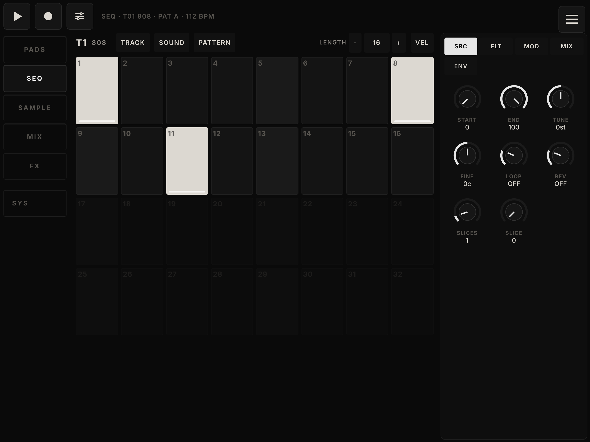
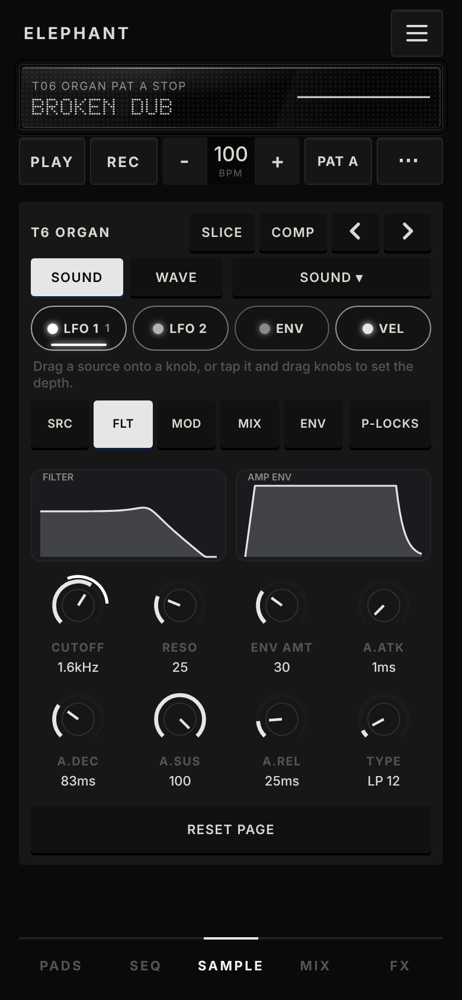
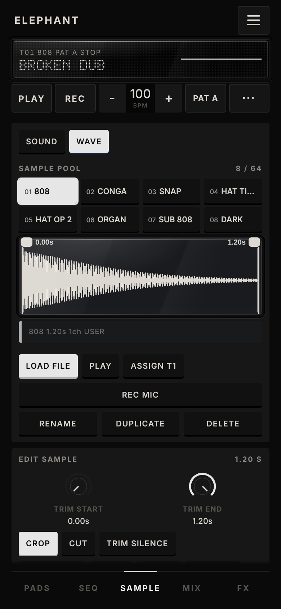
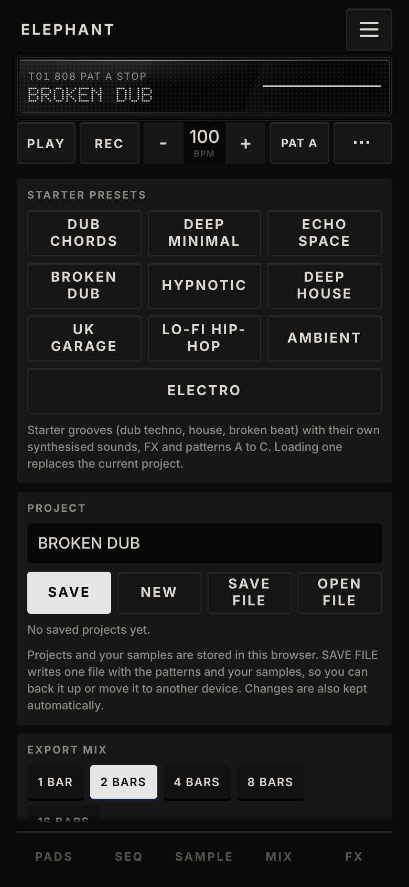

# ELEPHANT

A pocket sampler groovebox that runs in the browser: 16 pads, a step sequencer with parameter locks, a sampler (record, import, slice), a modulation matrix and an FX section. One HTML file, no dependencies, built for touch screens (phones and tablets). Works with a computer keyboard and MIDI pads too, and installs as an app that runs offline. Member of a design family with [GRAINS](https://shoogaze.github.io/grains-synth/) and [BEHEMOTH](https://shoogaze.github.io/behemoth-synth-/).

**Try it:** open [ELEPHANT](https://shoogaze.github.io/elephant-sequencer/) on your phone and tap the screen to start audio. On an iPhone or iPad use *Share → Add to Home Screen* for a full-screen app.

## Screenshots

Phone held sideways (the main way to play): PADS, SEQ, SAMPLE and MIX, the menu drawer, and the same layout on a tablet. One button row sits on top of every tab, so the screen never jumps when you change tabs.

<p>
  
  
</p>
<p>
  
  
</p>
<p>
  
  
</p>

Phone upright: PADS, SEQ, SAMPLE with its filter page, the wave pool, MIX, FX and the ≡ system page. Transport and tab bar stay in place, the screen scrolls.

<p>
  
  
  
  
</p>
<p>
  
  
  
  
</p>

The screenshots are made with Chromium at 2x (`python3 tools/shots.py`). The app uses system fonts only and makes no network requests.

## Features

**Sound**
- 16 pads, each one a sampler track. The project starts empty, with nine starter grooves one tap away (START FROM): tap a pad to load a sample (LOADED, MY FILES, or ADD FROM PHONE), record from the microphone, or grab the master output
- Sampler: start and end, tune, loop, reverse, eight filter types (LP12, LP24, HP, BAND, NOTCH, LADDER, COMB, FORMANT), amp and filter envelopes, two LFOs
- Slicing is a switch: SLICE is off by default (the wave is one region you trim with your fingers); turn it on to cut the sample into 2 to 16 slices and tap a slice to play it
- Wave editor gestures: drag the two edges to trim, swipe to draw a region, pinch to zoom, drag to pan, double tap to reset
- Modulation matrix: drag LFO 1, LFO 2, ENV or VEL onto a knob (cutoff, tune, level, pan); the ring shows the depth, drag the knob to set it, double tap to remove
- FX: delay, chorus and reverb on send buses (AudioWorklet engine shared with BEHEMOTH), master filter, compressor/limiter, plus a compressor on any single track

**Sequencer**
- Digitakt-style: up to 64 steps per track, parameter locks, trig conditions, micro timing, retrigs and a euclid generator
- With a step selected the SOUND knobs write p-locks, without one they edit the whole track
- 8 patterns and a song chain

**Workflow**
- MIX page with master and track levels, mute, solo and sidechain per track
- Project save/open as a file, undo, WAV and stem export
- 71 built-in sounds (kicks, snares, hats, percussion, basses, chord stabs, pads, FX) and 10 starter presets with their own kits and chord sounds
- Computer keyboard: pads 1-16 on `7 8 9 0 / U I O P / J K L ; / M , . /`, SPACE starts and stops
- MIDI in: drum pads on channel 10 (notes 36-51) play the selected track, pitch bend and mod wheel are supported
- Tabs: PADS, SEQ, SAMPLE (SOUND and WAVE pages), MIX, FX; the ≡ button (top right) opens SYS: settings, tutorial, backup
- Step-by-step tutorial and tips (replay it from ≡)
- Interface languages: English (default) and Russian; choose it on the SYS page (LANGUAGE)
- Interface levels (SYS, INTERFACE): SIMPLE (default) shows PADS, SEQ, SAMPLE and MIX only, with SRC and FLT on the sample page and the master FX under the mixer; ADVANCED adds the FX tab, p-locks, the modulation strip and every sound page; SEQ ONLY is simple without the pads tab

**Phones and tablets**
- Landscape (phone and tablet): full-screen layout with one button row on top of every tab, big pads, a 32-step grid (tap a dim step to extend the pattern to it), an encoder column on the right, a swipeable mixer; zoom adapts to the tablet size
- Portrait layout for phones, safe areas and dynamic viewport height for notched phones
- Installable as an app (PWA): fullscreen, works offline once loaded

## Run

Open `index.html` in a modern browser and tap the screen to start audio. Opening the file directly works, except for the offline service worker. To try it locally with the service worker:

```
python3 -m http.server
```

Then open `http://localhost:8000`. For install and offline use, serve the files over HTTPS, for example with GitHub Pages.

### GitHub Pages

Settings → Pages → Deploy from branch → `main` / root. The app is then available at `https://<user>.github.io/<repo>/`, for this repo [shoogaze.github.io/elephant-sequencer](https://shoogaze.github.io/elephant-sequencer/). On an iPad or iPhone use Share → Add to Home Screen, on Android use the Install app button in the browser menu.

## Files

| Path | Purpose |
| --- | --- |
| `index.html` | The whole app in one file: UI and audio engine. This is the file to open or deploy; it is built from `src/` |
| `src/engine/` | Audio engine in ordered parts: core, parameters, FX definitions, samples, project model, serialization, audio graph, voices, sequencer, presets, sound bank, WAV/ZIP, storage |
| `src/ui/` | Interface in ordered parts: helpers, controls, transport, shell, PLAY, SEQ, sound picker, step editor, SOUND, FX, MIX, samples, keyboard, loops, start, coach |
| `src/style.css` | All styles |
| `src/i18n.js` | Translations, generated by `gen_i18n.py` (do not edit by hand) |
| `gen_i18n.py` | Translation table to `src/i18n.js` |
| `build.py` | Joins the parts into `index.html` |
| `sw.js`, `icons/` | Offline cache and app icons |
| `screenshots/` | README screenshots (made by `tools/shots.py`) |
| `test/` | Playwright regression scripts (`python3 test/run_all.py`) |
| `tools/` | `css_tidy.py`, `styledump.py`, `visreg.py`, `viscmp.py` (CSS and visual-regression helpers), `shots.py` (README screenshots) |
| `.github/` | CI: builds and runs the tests on every push |
| `LICENSE` | MIT |

## Development

Edit the files in `src/`, then rebuild the single file (Python 3, no packages to install for the build):

```
python3 gen_i18n.py   # translations -> src/i18n.js
python3 build.py      # src/* -> index.html
```

The parts in `src/engine/` and `src/ui/` are plain JavaScript without their own wrapper. `build.py` sorts them by file name, puts each group inside one function scope and writes one self-contained `index.html`, so a part can use anything defined in an earlier part. Commit the generated `index.html` too, so the app works straight from GitHub Pages.

Browser tests use Playwright (Chromium):

```
pip install playwright && playwright install chromium
python3 gen_i18n.py && python3 build.py
python3 test/run_all.py
```

The scripts drive the built `index.html` in headless Chromium and fail on any page error or failed check.

## Browser support

Current Chrome, Edge, Safari and Firefox, tested mainly in Chromium; Safari and iPad behaviour is less covered, bug reports with device and iOS version are welcome. Web MIDI is available in Chromium-based browsers, not in iOS Safari. The microphone is blocked inside sandboxed iframes, so open the app as its own page. Audio starts only after the first tap (browser autoplay rules).

## The family

Three instruments in one black-and-white design, each a single HTML file that runs offline. Open them on the same phone or tablet and add the ones you like to the Home Screen.

| App | What it is | Open | Source |
| --- | --- | --- | --- |
| **ELEPHANT** | Pocket sampler groovebox: 16 pads, p-lock sequencer, sampler, FX | [shoogaze.github.io/elephant-sequencer](https://shoogaze.github.io/elephant-sequencer/) | [SHOOGAZE/elephant-sequencer](https://github.com/SHOOGAZE/elephant-sequencer) |
| **BEHEMOTH** | Wavetable bass synthesizer with a modulation matrix | [shoogaze.github.io/behemoth-synth-](https://shoogaze.github.io/behemoth-synth-/) | [SHOOGAZE/behemoth-synth-](https://github.com/SHOOGAZE/behemoth-synth-) |
| **GRAINS** | Granular sampler and playable instrument | [shoogaze.github.io/grains-synth](https://shoogaze.github.io/grains-synth/) | [SHOOGAZE/grains-synth](https://github.com/SHOOGAZE/grains-synth) |

## License

[MIT](LICENSE). Copyright (c) 2026 Kirill Kinderhart.
