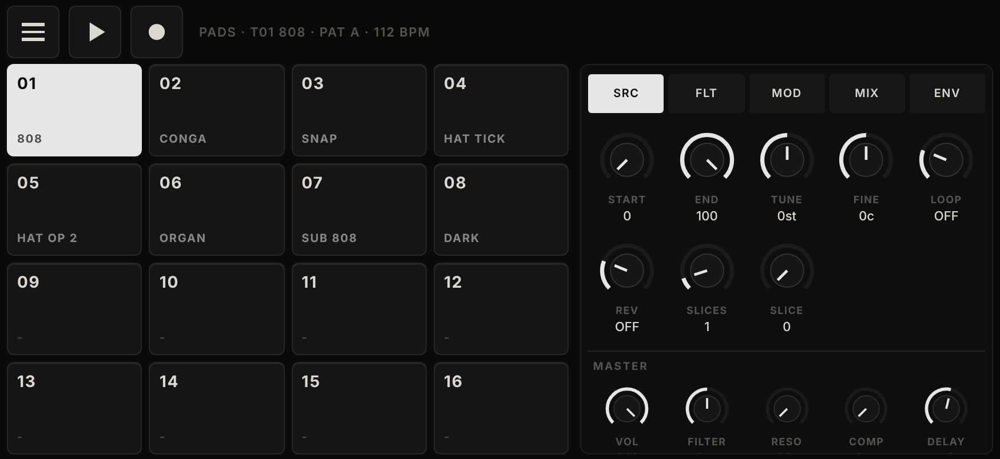
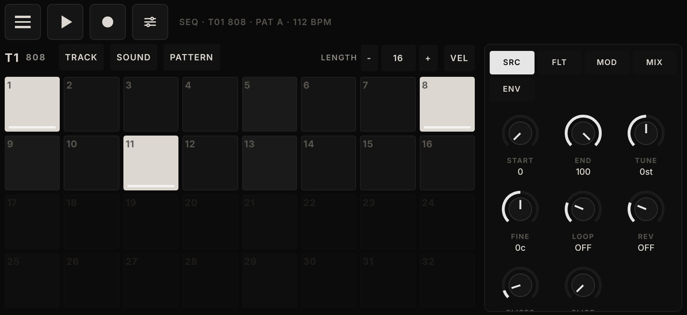
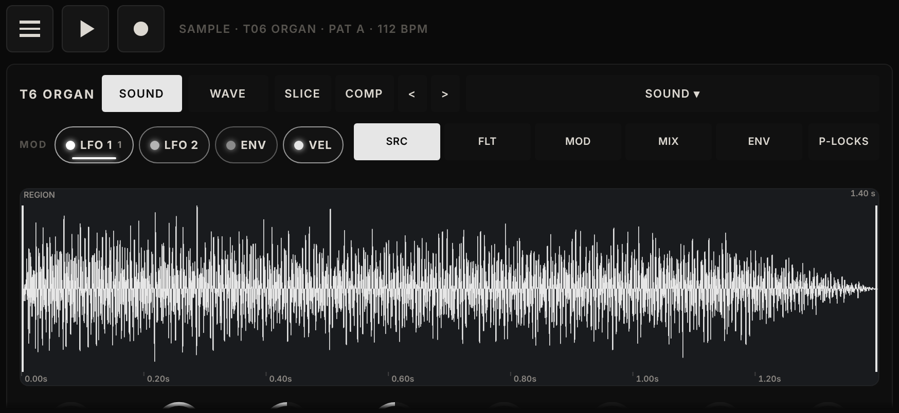
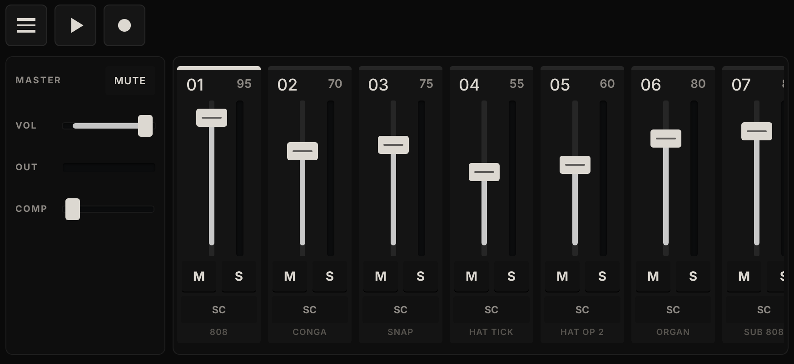
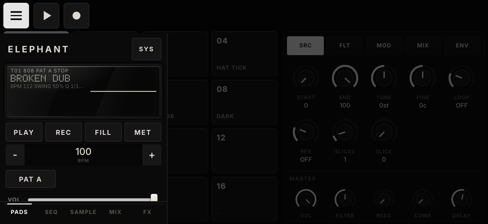
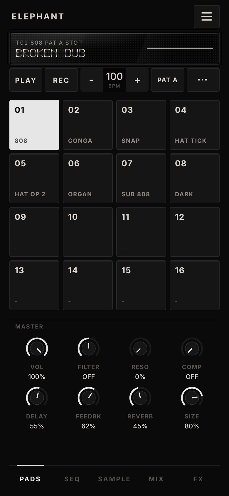
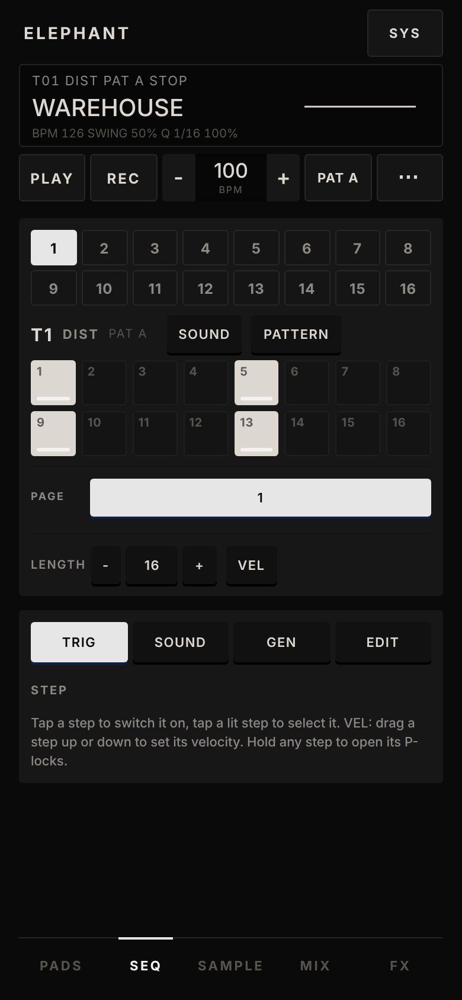
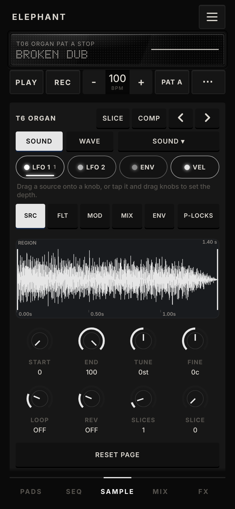
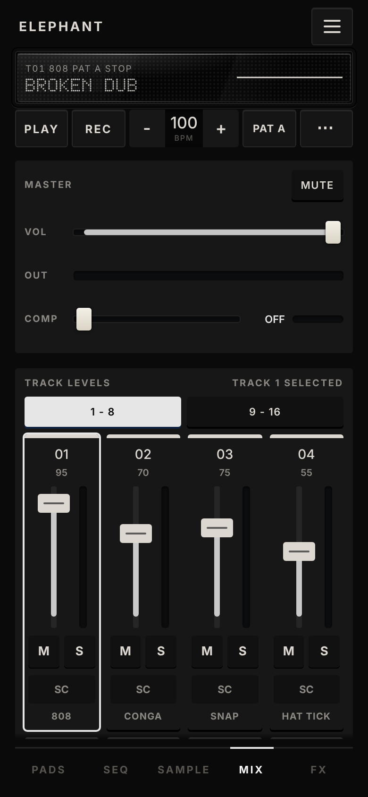
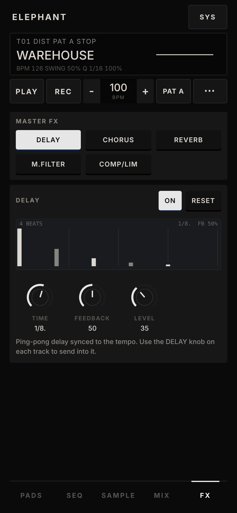

# ELEPHANT

A pocket sampler groovebox that runs in the browser, sibling of the BEHEMOTH synth. 16 pads, a step sequencer, a sampler (record, import, slice), a modulation matrix and an FX section, built for phones and tablets. One HTML file, no dependencies, works offline once opened.

**Try it:** open the GitHub Pages link of this repo on your phone, then *Share → Add to Home Screen* for a full-screen app.

Try it: open [https://shoogaze.github.io/behemoth-synth-/ ](https://shoogaze.github.io/elephant-sequencer/) on your phone and tap the screen to start audio. On an iPhone or iPad use Share → Add to Home Screen for a full-screen app.

## Screenshots

Phone held sideways (the main way to play), a phone upright, and a tablet. Shots are taken from the built `index.html` with the WAREHOUSE preset loaded.

| | |
|---|---|
|  |  |
| **PADS**: big square pads on the left, the sound's encoders and the master section on the right | **SEQ**: track keys, 2 x 8 steps, page, length and velocity bar, encoders for the selected track |
|  |  |
| **SAMPLE**: controls on top, scroll down for the detailed wave (exact min/max per pixel, time ruler, pinch to zoom) and the knobs | **MIX**: master on the left, big faders you swipe sideways, track name under each strip |
|  | |
| **Menu**: the button rail stays in place, the drawer slides out beside it (BPM, pattern, undo, tabs) | |

**Phone upright** (PADS, SEQ, SAMPLE, MIX, FX): transport and tab bar stay in place, the screen scrolls.

<p>





</p>


*Tablet in landscape: the same layout scaled up, the steps fill the height.*

The screenshots are made with Chromium at 2x (`python3 tools/shots.py`), without the web fonts, so the real app looks slightly different on a device that loads Hanken Grotesk and DM Mono.

## Features

- **16 pads**, each one a sampler track. The project starts empty: tap a pad to load a sample (LOADED, MY FILES, or ADD FROM PHONE), record from the microphone, or grab the master output
- **Digitakt-style sequencer:** up to 64 steps per track, parameter locks, trig conditions, micro timing, retrigs, euclid generator, 8 patterns and a song chain. The SOUND tab sits right under the trigs: with a step selected the knobs write p-locks, without one they edit the track
- **Sampler:** start and end, tune, loop, reverse, slices, eight filter types (LP12, LP24, HP, BAND, NOTCH, LADDER, COMB, FORMANT), amp and filter envelopes, two LFOs
- **Modulation matrix:** drag LFO 1, LFO 2, ENV or VEL onto a knob (cutoff, tune, level, pan); the ring shows the depth, drag the knob to set it, double tap to remove
- **FX:** delay, chorus and reverb on send buses (AudioWorklet engine shared with BEHEMOTH), master filter, compressor/limiter, plus a compressor on any single track
- **MIX** page with master and track levels, project save/open as a file, undo, WAV and stem export
- **Sound bank and presets:** 71 built-in sounds (kicks, snares, hats, percussion, basses, chord stabs, pads, FX) and 11 presets, most with their own kit and stab or chord sound
- **Five tabs:** PADS, SEQ, SAMPLE (SOUND and WAVE), MIX, FX; SYS lives in the header
- **Landscape (phone and tablet):** full-screen layout with a button rail, big square pads or steps, an encoder column on the right, a swipeable mixer; the menu opens from the button
- **Computer keyboard:** pads 1-16 on 7 8 9 0 / U I O P / J K L ; / M , . /, SPACE starts and stops
- Strict monochrome look, shared with the BEHEMOTH synth

## Run locally

```
python3 -m http.server
```

Then open `http://localhost:8000`. Opening `index.html` directly also works, except for the offline service worker.

## Build from source

`index.html` is generated from `src/`:

```
python3 gen_i18n.py   # translations -> src/i18n.js
python3 build.py      # src/* -> index.html
```

## Tests

Browser tests use Playwright (Chromium):

```
pip install playwright && playwright install chromium
python3 gen_i18n.py && python3 build.py
python3 test/run_all.py
```

The scripts drive the built `index.html` in headless Chromium and fail on any page error or failed check.

## Known limitations

- Web MIDI is not available in iOS Safari, so MIDI input is desktop-Chrome only.
- The microphone is blocked inside sandboxed iframes; open the app as its own page.
- Tested mainly in Chromium; Safari and iPad behaviour is less covered. Bug reports with device and iOS version are welcome.
- Audio starts only after the first tap (browser autoplay rules).

## Layout

```
index.html       built app (served by GitHub Pages)
sw.js            offline cache
screenshots/     images for this README (made by tools/shots.py)
icons/           app icon: icon.svg and png in several sizes (favicon, home screen, manifest)
src/engine/      audio engine in ordered parts: core, parameters, FX definitions,
                 samples, project model, serialization, audio graph, voices,
                 sequencer, WAV/ZIP, storage, presets, sound bank
src/ui/          interface in ordered parts: helpers, controls, transport, shell, PLAY,
                 SEQ, sound picker, step editor, SOUND, FX, MIX, samples, keyboard,
                 loops, start, coach
src/style.css    all styles
src/i18n.js      generated from gen_i18n.py (do not edit by hand)
gen_i18n.py      translation table -> src/i18n.js
build.py         joins the parts into index.html
test/            Playwright regression scripts (python3 test/run_all.py)
tools/           CSS and visual-regression helpers (css_tidy.py, styledump.py, visreg.py, viscmp.py) and shots.py for the README screenshots
.github/         CI: builds and runs the tests on every push
```

The parts in `src/engine/` and `src/ui/` are plain JavaScript without their own wrapper. `build.py` sorts them by file name, puts each group inside one function scope and writes one self-contained `index.html`, so a part can use anything defined in an earlier part. After a change: `python3 gen_i18n.py && python3 build.py`, then `python3 test/run_all.py`.

## License

MIT, see [LICENSE](LICENSE). Copyright (c) 2026 Kirill Kinderhart.
